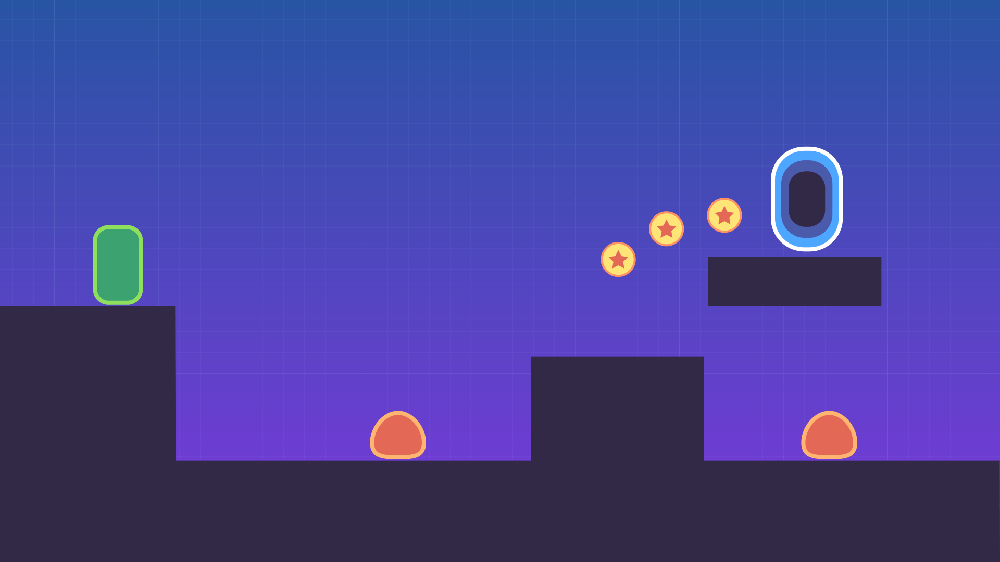

# Your First Game Godot 2d Platformer

This is the complete Open Source Project for our upcoming free beginner Godot 2D Platformer course. It will show you how to create your first Godot game from start to finish.

➡ Follow us on [Twitter](https://twitter.com/NathanGDQuest) and [YouTube](https://www.youtube.com/c/gdquest/) for free game creation tutorials, tips, and news! Get one of our [Godot game creation courses](https://gdquest.mavenseed.com/) to support our work on Free Software.



## What you'll learn

- Build a platform game with connected levels, pass through platforms, coins, enemies…
- Design a title screen, pause menu, and score counter
- Learn some good Godot programming practices to keep your projects organized

## Prerequisites

- You will need some **basic understanding of GDScript**, which we cover in our [introduction to GDScript](https://www.youtube.com/watch?v=UcdwP1Q2UlU). GDScript is the programming language you will use in Godot to code your games.

We also recommend reading the great [step-by-step guide](http://docs.godotengine.org/en/stable/getting_started/step_by_step/index.html) in the official Godot docs, if you haven't already.

## Godot 4

This course was originally made with Godot 3. Since then, there have been several changes to the engine code. If you'd like to run this project with Godot 4, a port is available in the `godot4-game` folder.

*Currently, this port only exists for the GDScript version of the project. The C# version has yet to be ported.*

## How to get this free course

The course will come out on our YouTube channel at the end of September. To get it, [subscribe to the GDQuest channel](https://youtube.com/c/gdquest) and click the notification bell to know when it is out.

We will also release a free introduction to steering behaviours soon, designed to be beginner-friendly as well!

## Support gdquest

This free series is sponsored by our [platformer game creation course](https://gdquest.mavenseed.com).

GDQuest is a social company focused on education and bringing people together around Free Software.

We share **the techniques professionals use to make games** and open source the code for most of our projects on [our GitHub page](https://github.com/GDquest/).

You can:

- Join the community on [Discord](https://discord.gg/dKUX7m3)
- Follow us on [Twitter](https://twitter.com/NathanGDQuest)

## AI Agent Telemetry & Logging System

Just like in Game 1, Game 2 is equipped with an automated real-time state export and event logging system for AI agents, RL models, and automated bots.

### Log Outputs
- **`latest_state.json`**: Atomically overwritten at ~15 Hz (every 4 frames) with a complete telemetry snapshot:
  - **Player**: Position `(x, y)`, velocity `(vel_x, vel_y)`, floor/wall/ceiling collision status, facing direction, jump/stomp impulses, hitbox dimensions, and downward ground raycast distance.
  - **Inputs**: Current actions (`move_left`, `move_right`, `jump`, `pause`, raw directional vector).
  - **Coins**: Remaining coins, collected coins, nearest coin with Euclidean distance and relative offset `(dx, dy)`, plus list of 8 nearest coins.
  - **Enemies**: Total active enemies, nearest enemy with position, velocity, distance, stompability status (`player_is_above` and `is_stompable`), and threat flag.
  - **Goal / Portal**: Exit portal position, distance to portal, relative distance.
  - **Game State & Meta**: Current scene (`Level01`, `Level02`, `MainScreen`, `EndScreen`), state (`playing`, `paused`, `player_died`, `victory`), score, deaths, frame number, timestamp, session time, and FPS.
- **`game_events.jsonl`**: Append-only event sequence log for training and post-run analysis. Logs:
  - `session_start`
  - `player_spawned`
  - `player_jump`
  - `player_stomp`
  - `coin_collected`
  - `enemy_killed`
  - `player_died`
  - `player_reset`
  - `level_cleared`
  - `scene_changed`
  - `periodic_snapshot` (every ~1 sec)

### Running the Live Telemetry Monitor
1. Double-click `run_game.bat` to launch the game.
2. In a separate terminal, double-click `run_reader.bat` (or run `python log_reader.py`) to watch the live telemetry HUD stream in real time.

### Using with an AI Agent in Python
```python
from log_reader import GameStateReader
import time

reader = GameStateReader()

# 1. Real-time state polling loop
while True:
    state = reader.get_latest_state()
    if state and state.get("game_state") == "playing":
        player = state["player"]
        nearest_coin = state["coins"]["nearest_coin"]
        closest_enemy = state["enemies"]["closest_enemy"]
        
        # Example decision logic:
        if closest_enemy and closest_enemy["is_threat"]:
            print("Threat detected! Jump or evade!")
    time.sleep(0.05)

# 2. Or stream events
for event in reader.stream_events():
    print(f"Event occurred: {event['event']} at frame {event['frame']}")
```
